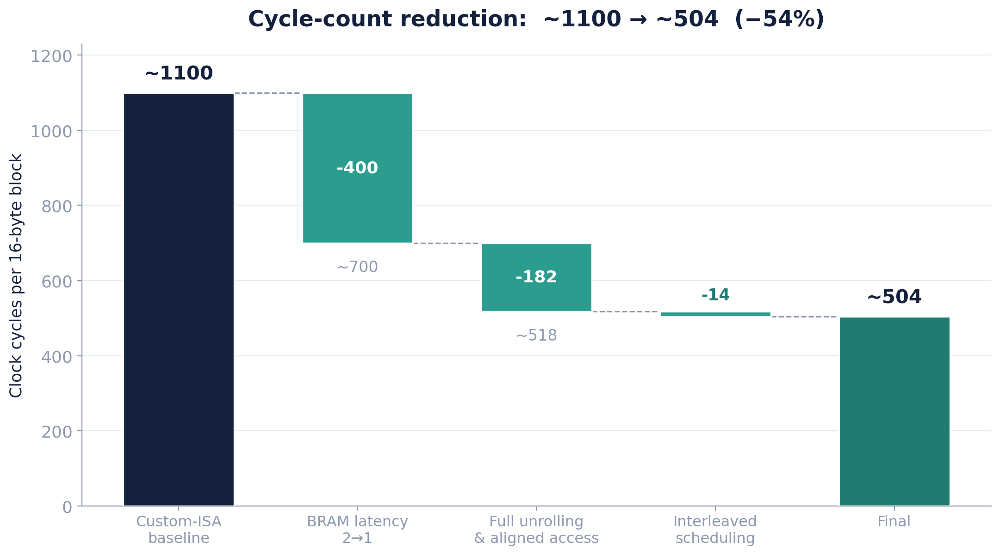

# RISC-V AES-128 Accelerator

AES-128 encryption on a CV32E40P (RI5CY) RISC-V soft core, sped up from **6120 to 504 clock cycles per block** by adding the RISC-V scalar-crypto instructions (`aes32esmi`, `aes32esi`, `aes32ks1i`, `aes32ks2`) to the core and rewriting the software around the pipeline.

Group project for the Processor Design Project course (CESE4040, TU Delft, 2025–2026). Target: Zynq-7020, Vivado 2024.2.

## Results

| Version | Cycles | Status |
|---|---|---|
| Pure-software AES (course baseline) | 6120 | simulated, passed |
| Custom AES instructions, 2-cycle BRAM reads | ~1100 | simulated |
| + 1-cycle BRAM reads, fully unrolled rounds | 614 | simulated, passed |
| + aligned word load/store, interleaved columns | **504** | simulated, passed |

Cycles are counted in Vivado xsim from fetch-enable until the CPU writes the done marker; the ciphertext is checked against the expected value.



## What we changed

- **AES unit in the EX stage** (`hardware/src/design/riscy/cv32e40p_aes_unit.sv`): S-box, MixColumns and key-schedule logic, decoded as four new instructions.
- **BRAM read latency 2 → 1** in `riscv_top_bram.v`, matching the real latency of the BRAM IP. This was the largest single saving.
- **Software** (`final/modified_main.c`): hardware key schedule, fully unrolled rounds, aligned `lw`/`sw` instead of byte accesses, and the four state columns interleaved so consecutive AES instructions do not stall on each other.

Details and reasoning: [docs/optimization.md](docs/optimization.md).

## Layout

| Path | Contents |
|---|---|
| tag `baseline` | Course starting point: unmodified core and software AES |
| `hardware/` | SoC RTL with the AES instructions, testbench, Vivado scripts |
| `software/` | Toolchain setup and the AES test program for the new instructions |
| `final/modified_main.c` | Software of the 504-cycle submission |

`git diff baseline main -- hardware` shows exactly what was added to the core.

`hardware/` and `software/` are the last state of our hardware branch. The submitted 504-cycle version additionally uses `final/modified_main.c` and the BRAM latency change above; that branch lives on the course GitLab.

## Build

Needs LLVM/Clang with a RISC-V GCC toolchain (paths in `software/config/rv32-standard.conf`) and Vivado 2024.2.

```sh
cd software && make soft        # compile, generate the BRAM .coe files
```

Then, in the Vivado Tcl console from `hardware/`:

```tcl
source ./scripts/create_project.tcl
source ./scripts/run_simulation.tcl
```

## Credits

The base SoC, testbench and scripts were provided by the CESE4040 course staff. The core is [OpenHW CV32E40P](https://github.com/openhwgroup/cv32e40p) (Solderpad Hardware License, headers kept). The AES extension and software optimization are the work of project group 07.
